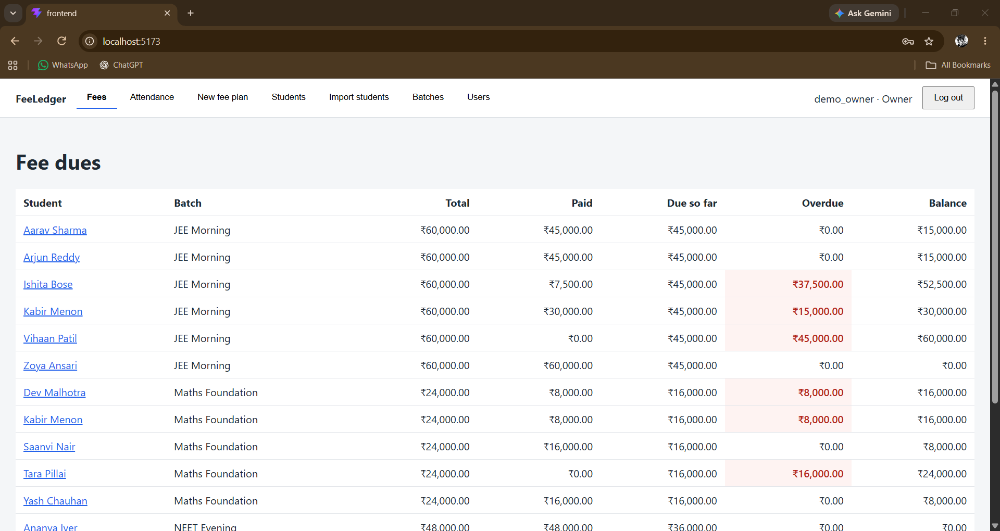
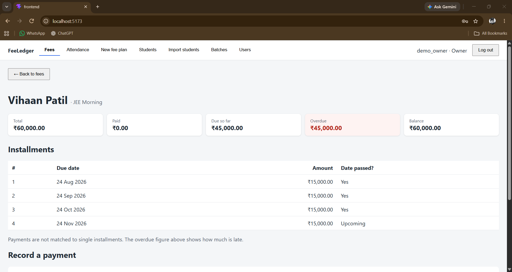
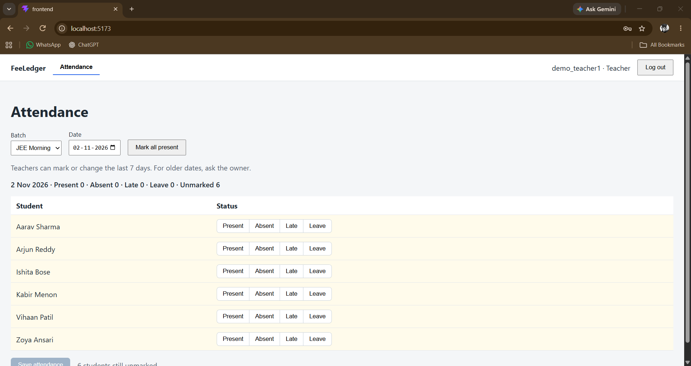
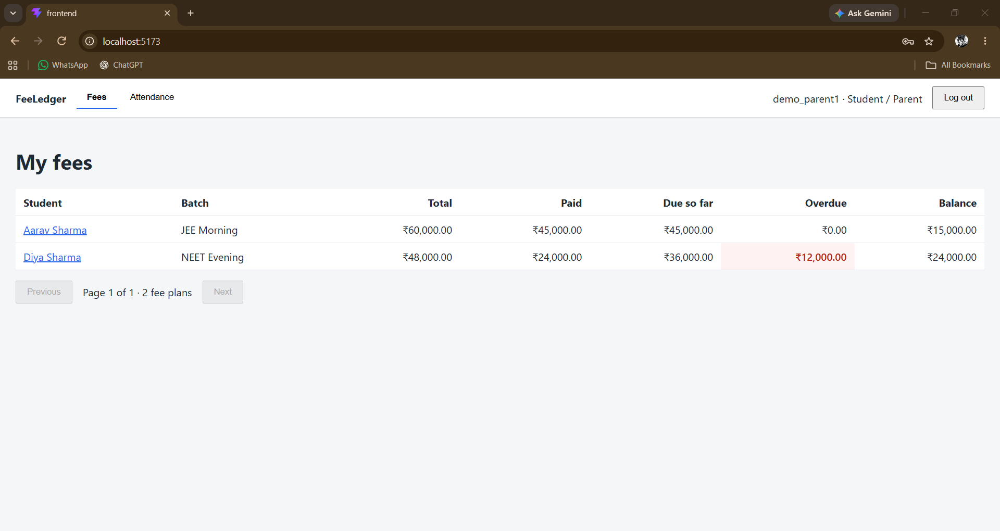
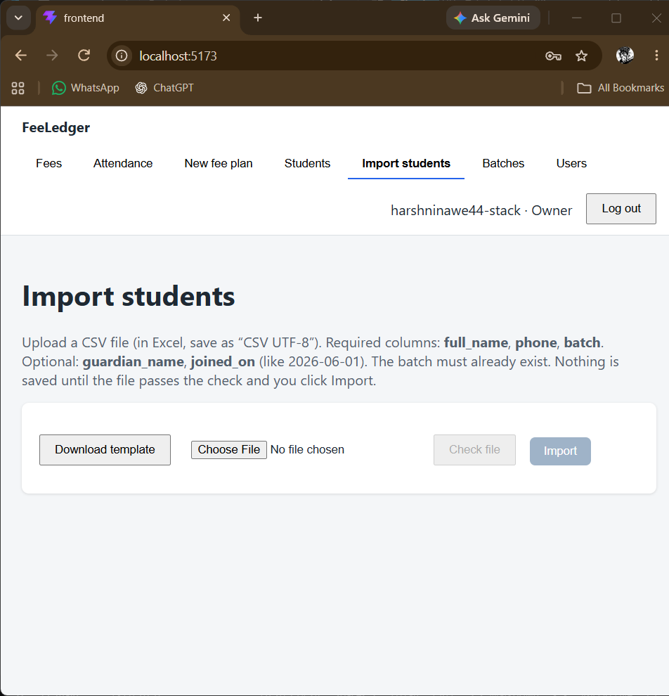

# FeeLedger

[](https://github.com/harshninawe44-stack/FeeLedger/actions/workflows/ci.yml)

A fee and attendance manager for small coaching classes. Fees are split into installments and paid into an **append-only ledger**, teachers see **only their own batches**, and dues are computed by the database in a single query.



## Why this exists

Small coaching classes usually run on notebooks, WhatsApp and spreadsheets. Numbers get overwritten, nobody can say quickly who still owes money, and every teacher can see more than they should. FeeLedger replaces that with one place where:

- every rupee received is recorded permanently and can be audited,
- the owner sees who is overdue at a glance,
- teachers mark attendance for their own batches only,
- parents see their own child's fees and attendance, and nothing else.

## Screenshots

| Plan detail with a reversed payment | Teacher's attendance sheet |
|---|---|
|  |  |

| Parent's view | CSV import with row errors |
|---|---|
|  |  |

## What each role can do

| Role | Can do |
|---|---|
| **Owner** | Manage accounts, batches and students. Create fee plans. Record and reverse payments. See all dues. Import students from CSV. Mark attendance for any batch. |
| **Teacher** | Mark and correct attendance for their own batches (last 7 days). Sees no fee information at all. |
| **Parent / student** | Read-only view of their own children's fees, payment history and attendance. |

## Design decisions

### 1. The ledger is append-only
A payment is never edited or deleted. A mistake is fixed by adding a **reversal** entry: a negative row that points at the original payment and carries a required reason. The full story stays visible.

This is enforced at three levels, so no single bug can break it:
- a PostgreSQL **trigger** rejects any `UPDATE` or `DELETE` on the ledger table, even from raw SQL,
- **check constraints** force payments to be positive, reversals negative, and reversals to point at a payment,
- the only code path that writes the ledger is a small set of service functions, which also stop overpayment and double reversal. They lock the rows they check, so two simultaneous requests cannot both pass.

### 2. Money is exact
Amounts are `Decimal` in Python and `NUMERIC` in the database, never floats. The API sends money as **strings** (`"15000.00"`), and the React app never does arithmetic on it: it only formats the text (including Indian grouping, `₹1,00,000.00`).

Splitting a fee works in whole paise, and the leftover paise go to the earliest installments, so ₹10,000 in three parts is 3333.34 + 3333.33 + 3333.33 and always adds back to exactly ₹10,000. Totals too small to split are rejected rather than producing zero-rupee installments.

### 3. Permissions live in the queries, not in the UI
A small set of scoping functions (`batches_for(user)`, `fee_plans_for(user)` and so on) is the only place that decides which rows a user can reach. Every view starts from them. Asking for a row you are not allowed to see returns **404**, as if it did not exist, so one teacher cannot even confirm that another teacher's batch exists. Hiding a menu tab is only cosmetic.

### 4. No N+1 queries
The dues report is one SQL query. Each total (paid, due so far) is its own **subquery**, because joining installments and ledger rows together and summing would silently multiply the numbers. List endpoints use `select_related`, `prefetch_related` and `Exists` annotations. Tests count queries, add more rows, and fail if the count grows.

### 5. Other deliberate choices
- **Attendance can be corrected, but every change is logged** (who, when, old and new status), and teachers can only change the last 7 days.
- **CSV import is all-or-nothing.** The owner first checks the file (nothing saved), sees every bad row with its line number, and only then imports. Re-uploading a file by accident cannot create duplicates.
- **The Django admin is read-only** for fee plans, installments, the ledger and attendance, so the rules above cannot be bypassed through it.
- **Login is session based**, with CSRF protection on every state-changing request and a rate limit on the login endpoint. New accounts must pass Django's password rules. Owner accounts cannot be created through the API.

## Tech stack

Python, Django, Django REST Framework, PostgreSQL, React (Vite). Tested with Python 3.13 and Node 24.

## Run it locally

Commands are for Windows PowerShell. On macOS or Linux, use `source venv/bin/activate` and `cp`.

**1. Backend**
```
python -m venv venv
.\venv\Scripts\activate
pip install -r requirements.txt
copy .env.example .env
```
Create an empty PostgreSQL database named `feeledger`, then fill in `.env` (the database password, and a new `SECRET_KEY`):
```
python -c "from django.core.management.utils import get_random_secret_key; print(get_random_secret_key())"
```
```
python manage.py migrate
python manage.py createsuperuser
python manage.py runserver
```

**2. Frontend** (in a second terminal)
```
cd frontend
npm install
npm run dev
```
Open **http://localhost:5173** (use `localhost`, not `127.0.0.1`).

### Try it with demo data
The demo command fills an **empty** database with 3 batches, 15 students, payments in several states (including one mistaken payment that was reversed) and a week of attendance. It refuses to run if `DEBUG` is off or if the database already has data, so use a separate database:
```
psql -U postgres -h localhost -c "CREATE DATABASE feeledger_demo;"
$env:DB_NAME = "feeledger_demo"
python manage.py migrate
python manage.py seed_demo
python manage.py runserver
```
Every demo account uses the password `Demo-Pass-2026`. These accounts are for local use only.

| Account | Role |
|---|---|
| `demo_owner` | Owner (created if the database has no owner yet) |
| `demo_teacher1`, `demo_teacher2`, `demo_teacher3` | Teachers, one batch each |
| `demo_parent1` to `demo_parent5` | Parents. `demo_parent1` has two children. |

### Run it with Docker
One command starts the app and a PostgreSQL database (needs Docker):
```
docker compose up --build
```
Open **http://localhost:8000** and sign in as `owner` / `Local-Owner-Pass-2026`. These credentials are for local use only. In a real deployment, set your own `SECRET_KEY`, `ALLOWED_HOSTS`, `DATABASE_URL`, `PRODUCTION=True`, and `OWNER_USERNAME` and `OWNER_PASSWORD` (the first owner account is created once, from these two values, when the server starts).

### Run the tests
```
python manage.py test --keepdb
```
There are **228 automated tests**: ledger rules and arithmetic, permission scoping for every role, query counts, attendance rules, CSV import, login and CSRF, and the admin lock-down.

## API at a glance

All endpoints live under `/api/` and require login, except the first three.

| Endpoint | Purpose | Who |
|---|---|---|
| `auth/csrf/`, `auth/login/`, `auth/logout/` | Session login | everyone |
| `me/` | Who am I? | logged in |
| `batches/`, `students/` | Read, and create or edit (owner) | scoped by role |
| `enrollments/` | Enrol a student in a